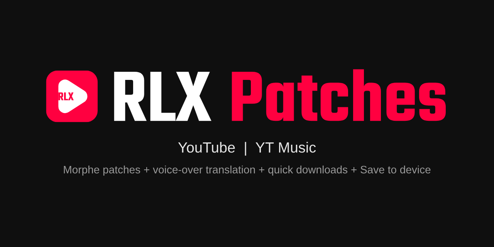

# RLX Patches

Morphe patches + voice over translation + extra features for YouTube and YouTube Music.

<a href="https://morphe.software/add-source?github=Ramik4/rlx-patches&name=RLX%20Patches">Add to Morphe Manager</a>

## About

RLX Patches is one patch bundle for **YouTube** and **YouTube Music**. It contains every
patch of [Morphe Patches](https://github.com/MorpheApp/morphe-patches), plus:

- **Voice over translation (Yandex)**, built in: a player button that plays a Yandex voice-over
  translation of the video (YouTube). Settings are in *Video → Voice over translation*, next to
  Morphe's own voice over translation of the captions.
- **Save to device**: a downloader for videos, audio, thumbnails and subtitles, with a quality
  picker, a library of the saved videos and an offline player with SponsorBlock (YouTube, off by
  default). Files go to *Download/YouTube*. Settings are in *Downloads*.
- **Quick download menu** for [YTindir](https://github.com/Ramik4/ytindir) (YouTube and YouTube
  Music): the download button opens the video's qualities with frame rate, codec and file size,
  audio only (M4A or MP3) and the thumbnail; *Download* queues the marked one in YTindir, *All
  options* opens YTindir's download window with all its settings.
- **RLX branding**: RLX app icons (red, green, layered), header logos, startup animation and app
  names, next to the original YT ones.
- **RLX settings**: the settings in fewer, clearer sections (YouTube): *RLX Customizations* (app
  name, icon, logo, font, theme colors, settings name, language, import/export), *General*, *Feed*,
  *Video*, *Player*, *Swipe and seekbar*, *Shorts*, *Downloads*, *Ads*, *Community services*
  (Return YouTube Dislike, SponsorBlock, DeArrow) and *Miscellaneous*. Every Morphe setting is
  still there, with the same keys, so exported settings work in both.
- **RLX default settings**, applied once, which you can change; your settings are kept on updates.
  *Restore RLX default settings* sets all settings back to them (channel whitelists, Spoof video
  streams and the PoToken provider are kept).
- **Theme colors**: dark `#0F0F0F` and light `#F0F0F0` by default (YouTube Music: dark `#0F0F0F`),
  from the startup screen on; any other color, pure black too, can be selected in the app.
- **About page** with the RLX and Morphe versions, update check, release notes, links and credits.
- No notice on the first start of an app version newer than the recommended one.

RLX is an independent project. It is not affiliated with, or endorsed by, Morphe, Google or
YouTube.

## Install

1. <a href="https://morphe.software/add-source?github=Ramik4/rlx-patches&name=RLX%20Patches">Add this RLX Patches</a> repository as a patch source with the link above, or add
   `https://github.com/Ramik4/rlx-patches` under **Sources → + → Remote**.
2. Patch YouTube or YouTube Music with the **RLX Patches** source. Morphe Manager shows the
   supported app versions and lets you know when a new RLX release is out.

Releases are signed with the RLX key; Morphe Manager refuses a file that was changed after it
was published.

## Credits

| | |
| --- | --- |
| [Morphe](https://github.com/MorpheApp/morphe-patches) | Morphe Patches, which RLX is based on |
| [ReVanced](https://github.com/ReVanced) and [ReVanced Extended](https://github.com/inotia00/revanced-patches) | Prior work Morphe Patches are based on |
| [MicroG RE](https://github.com/MorpheApp/MicroG-RE) | Google services for the patched apps |
| [inotia00](https://github.com/inotia00) | Spoof video streams, [PotHelper](https://github.com/MorpheApp/PotHelper) |
| [MarcaDian](https://github.com/MarcaDian) | Voice over translation |
| [sashade8](https://github.com/sashade8-ship-it) | Voice over translation (Yandex), [YaVoT](https://github.com/sashade8-ship-it/morphe-patches-yavot) |
| [lavinhoque33](https://github.com/lavinhoque33) | Save to device |
| [Ramik4](https://github.com/Ramik4) | RLX Patches development, design and extra features |

More about the code of the RLX patches is in [rlx/README.md](rlx/README.md#rlx-patches).

## License

RLX Patches is licensed under the [GNU General Public License v3.0](LICENSE), with the
additional terms of GPLv3 section 7 in [NOTICE](NOTICE). Portions are provided by the Morphe
software project. RLX is a modified version of Morphe Patches; all RLX changes and their dates
can be found in the Git history of this repository.
